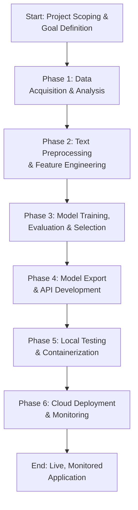

# 📧 NoSpamZone : Spam Email Detection System

<div align="center">


**An end-to-end Machine Learning project that detects spam emails using NLP and deploys the model as a production-ready web application.**

[Overview](#-project-overview) • [Demo](#-demo) • [Features](#-features) • [Tech Stack](#️-tech-stack) • [Pipeline](#-project-pipeline) • [Getting Started](#-getting-started) • [Results](#-results)

</div>

---

## 🎯 Project Overview

This project covers the **complete ML lifecycle** — from data exploration and preprocessing to model training, evaluation, and cloud deployment. The goal is to build a robust binary classifier that takes the content of an email as input and outputs a label: **`spam`** or **`ham`** (not spam).

Rather than relying on accuracy alone (which is misleading due to class imbalance), this project prioritizes **Precision, Recall, and F1-score** to ensure the model catches spam without misclassifying important legitimate emails.

---

## 🖼️ Demo

<div align="center">


*Paste an email → Get an instant spam/ham prediction with confidence score*

</div>

---

## 🗺️ Project Pipeline

The diagram below illustrates the complete end-to-end workflow of this project:

<div align="center">


</div>



> 💡 **Note:** The image `pipeline.png` is located in `docs/images/pipeline.png`. See the [Adding the Pipeline Diagram](#-adding-the-pipeline-diagram) section below for instructions on generating it.

---

## ✨ Features

- 🔤 **Text Preprocessing Pipeline** — Lowercasing, punctuation removal, tokenization, stop-word removal, lemmatization, and TF-IDF vectorization
- 🤖 **Multi-Model Comparison** — Trains and evaluates Naive Bayes, Logistic Regression, SVM, Random Forest, and Gradient Boosting classifiers
- 📊 **Robust Evaluation** — Uses precision, recall, and F1-score (not just accuracy) to handle class imbalance
- 🔌 **Production API** — RESTful API built with Flask for real-time spam predictions
- 🖥️ **Interactive Web Interface** — Simple frontend for users to paste email content and get instant classification
- 🐳 **Dockerized Deployment** — Fully containerized for reproducible deployment on any cloud platform
- ✅ **CI/CD Ready** — Automated testing and deployment pipeline

---

## 🛠️ Tech Stack

| Category | Technologies |
|----------|-------------|
| **Language** | Python 3.10+ |
| **Data Processing** | Pandas, NumPy |
| **NLP** | NLTK, Scikit-learn (TF-IDF, CountVectorizer) |
| **ML Models** | Scikit-learn, XGBoost |
| **API Framework** | Flask |
| **Frontend** | HTML, CSS, JavaScript |
| **Deployment** | Docker, Render / AWS / Heroku |
| **Testing** | Pytest |

---

## 📊 Dataset

- **Source**: [Spam Assassin Public Corpus](https://spamassassin.apache.org/old/publiccorpus/) / [Kaggle Email Spam Dataset](https://www.kaggle.com/datasets)
- **Size**: ~5,500+ labeled emails
- **Classes**: `ham` (legitimate) and `spam`
- **Sample structure**:

| Unnamed: 0 | label | text | label_num |
|-----------|-------|------|-----------|
| 605 | ham | "Subject: enron methanol ; meter # : 988291..." | 0 |
| 2349 | ham | "Subject: hpl nom for january 9 , 2001..." | 0 |
| 3624 | spam | "Subject: neon retreat\r\nho ho ho , we ' re ar..." | 1 |

---

## 🔬 Methodology

### ⚠️ The Golden Rule: Split First, Engineer Later

To prevent **data leakage**, the dataset is split **before** any feature engineering:

```
Raw Data → Train (70%) / Validation (15%) / Test (15%) → Feature Engineering → Training
```

- The TF-IDF vectorizer is fit **only** on the training set, then applied (transform-only) to validation and test sets
- This simulates real-world conditions where the model has never seen test emails

### Training Steps

1. **Data Splitting** — 70/15/15 train/validation/test split on raw text
2. **Feature Engineering** — TF-IDF fit on training data only
3. **Model Training** — Multiple classifiers with GridSearchCV hyperparameter tuning
4. **Evaluation** — Select best model based on F1-score and recall on the held-out test set
5. **Deployment** — Export champion model with `joblib`, serve predictions via containerized REST API

---

## 📈 Results

| Model | Accuracy | Precision | Recall | F1-Score |
|-------|----------|-----------|--------|----------|
| Naive Bayes | 96.2% | 95.8% | 94.1% | 94.9% |
| Logistic Regression | 97.5% | 97.1% | 96.3% | 96.7% |
| **Linear SVM** ⭐ | **98.4%** | **98.1%** | **97.6%** | **97.8%** |
| Random Forest | 97.9% | 97.4% | 97.1% | 97.2% |

> ✅ **Final Model**: Linear SVM with TF-IDF features achieved the best F1-score on the test set.

---

## 📁 Project Structure

```
spam-email-detector/
│
├── data/
│   ├── raw/                  # Original dataset
│   └── processed/            # Cleaned and split data
│
├── notebooks/
│   ├── 01_eda.ipynb          # Exploratory Data Analysis
│   ├── 02_preprocessing.ipynb
│   └── 03_model_training.ipynb
│
├── src/
│   ├── data_loader.py        # Load and split data
│   ├── preprocess.py         # Text cleaning & vectorization
│   ├── train.py              # Model training pipeline
│   ├── evaluate.py           # Evaluation metrics
│   └── predict.py            # Inference helper
│
├── models/
│   ├── spam_classifier.joblib
│   └── tfidf_vectorizer.joblib
│
├── app/
│   ├── app.py                # Flask app
│   ├── templates/
│   └── static/
│
├── tests/
│   └── test_api.py
│
├── docs/
│   └── images/
│       ├── pipeline.png      # ⬅️ Project pipeline diagram
│       └── demo.gif
│
├── Dockerfile
├── requirements.txt
├── .dockerignore
├── .gitignore
└── README.md
```

---

## 🚀 Getting Started

### 1. Clone the repository
```bash
git clone https://github.com/yourusername/spam-email-detector.git
cd spam-email-detector
```

### 2. Install dependencies
```bash
pip install -r requirements.txt
```

### 3. Train the model
```bash
python src/train.py
```

### 4. Run the API locally
```bash
python app/app.py
```

### 5. Test the API
```bash
curl -X POST http://localhost:5000/predict \
  -H "Content-Type: application/json" \
  -d '{"email_content": "Congratulations! You won a FREE iPhone. Click here now!"}'
```

**Response:**
```json
{
  "prediction": "spam",
  "probability": 0.9823
}
```

---

## 🐳 Docker Deployment

```bash
# Build the image
docker build -t spam-detector .

# Run the container
docker run -p 5000:5000 spam-detector
```

The API will be available at `http://localhost:5000`.

---

## ☁️ Cloud Deployment

This project supports one-click deployment on:

- **Render** — via `render.yaml`
- **AWS ECS** — via `ecs-task-definition.json`
- **Heroku** — via `Procfile`

See the `deployment/` folder for configuration details.

---

## 🖼️ Adding the Pipeline Diagram

The README references two images in `docs/images/`. Here's how to generate them:

### Option A — Use the Mermaid diagram (already embedded)
The pipeline is already rendered above using **Mermaid** (GitHub renders it natively). No image needed.

### Option B — Generate a PNG from the Mermaid diagram
1. Copy the Mermaid code block from the [Project Pipeline](#-project-pipeline) section
2. Paste it into the [Mermaid Live Editor](https://mermaid.live/)
3. Click **"Actions" → "Download PNG"**
4. Save the file as `docs/images/pipeline.png` in your repo
5. Commit it — the README will pick it up automatically

### Option C — Create a custom diagram (draw.io / Figma / Canva)
Design a custom flowchart with these phases:

| Phase | Description | Icons to include |
|-------|-------------|------------------|
| 1 | Data Acquisition & Analysis | 📂 CSV, 📊 Pandas |
| 2 | Text Preprocessing & Feature Engineering | 🧹 NLTK, 🔢 TF-IDF |
| 3 | Model Training, Evaluation & Selection | 🤖 Scikit-learn |
| 4 | Model Export & API Development | 💾 joblib, 🌶️ Flask |
| 5 | Local Testing & Containerization | 🐳 Docker |
| 6 | Cloud Deployment & Monitoring | ☁️ AWS/Render |

Save the result as `docs/images/pipeline.png`.

> 💡 **Tip:** Keep the image width between **1200–1600px** for crisp rendering on GitHub.

---

## 🧪 Running Tests

```bash
pytest tests/ -v
```

---

## 🔮 Future Improvements

- [ ] Add BERT-based transformer model for higher accuracy
- [ ] Implement model retraining pipeline with drift detection
- [ ] Support multilingual spam detection
- [ ] Add explainability (SHAP/LIME) to show *why* an email was flagged
- [ ] Add email header and URL analysis for richer features

---

## 🤝 Contributing

Contributions, issues, and feature requests are welcome! Feel free to check the [issues page](https://github.com/yourusername/spam-email-detector/issues).

1. Fork the project
2. Create your feature branch (`git checkout -b feature/AmazingFeature`)
3. Commit your changes (`git commit -m 'Add some AmazingFeature'`)
4. Push to the branch (`git push origin feature/AmazingFeature`)
5. Open a Pull Request

---

## 📄 License

This project is licensed under the **MIT License** — see the [LICENSE](LICENSE) file for details.

---

## 🙏 Acknowledgments

- [Spam Assassin Public Corpus](https://spamassassin.apache.org/old/publiccorpus/) for the dataset
- [Scikit-learn](https://scikit-learn.org/) documentation and tutorials
- The open-source ML community for inspiration and best practices

---

<div align="center">

⭐ **If you found this project useful, please give it a star!** ⭐

Made with ❤️ and ☕

</div>
